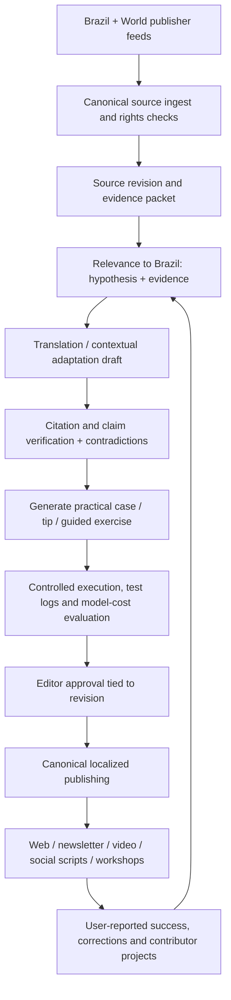

# Sintra Ponte Global: world intelligence translated into Brazilian capability

**Decision:** 2026-10-24. **Delivery:** isolated branch `feat/sintra-ponte-global-brasil-20261024` stacked on PR #32; no merge to production and no external model calls.

## Hypothesis to test

**International context is a differentiator only when it is translated into an actionable Brazilian workflow.**
A foreign-language AI headline, a translated newsletter or a generic prompt template alone does **not** provide a defensible moat. Competitors already do parts of this well:

| Reference | Demonstrated strength | Implication for Sintra |
|---|---|---|
| The Rundown AI / Rundown University | Publishes source-linked AI news and step-by-step guides, many free with optional progress saving | Sintra cannot claim globally unique practical AI guides |
| Ben's Bites | Combines editorial perspective, tutorials, reviewed tools and builder community (some paid) | Community/editor viewpoint and applied usefulness already have precedents |
| IA Brasil (ianobrasil.com.br) | Brazilian AI source aggregation and sectoral cases with origin links | Brazil-first news + case counts alone is not our product moat |
| Google NotebookLM | Makes source-grounded material navigable with study formats and citation references, while warning of inaccuracies | Quality must be evidence-linked and show uncertain or absent evidence |
| Sintra beta | 2 Brazilian RSS source adapters, 11 global adapters, first working *local rule-based* meeting notes lab | Can use existing editorial/source architecture but must avoid inventing model outcomes |

**Research sources checked 2026-10-24**:
- https://www.therundown.ai/
- https://app.therundown.ai/guides
- https://www.bensbites.com/about
- https://www.ianobrasil.com.br/casos/
- https://blog.google/innovation-and-ai/products/notebooklm/notebooklm-google-io-2026/

## What we implemented, and why

- **A typed three-item bridge registry:** `src/lib/ponteGlobalData.ts` explicitly ties each idea to an official international original source and captures editorial `globalContext`, `brazilApplication`, one useful `tip`, locally tailored `prompt`, a limitation and optional real lab route.
- **Three audience jobs:** a Brazilian small business drafting customer replies, a student studying with authorized source material, and a team turning meetings into traceable actions.
- **Source/trust boundary:** international publisher advice is identified separately from the Brazilian adaptation. No example is labeled as executed or a proven local deployment; all prompt outcomes still require user review.
- **Localized and mobile-first:** visitor selects a use case, optionally edits a scenario (280 character maximum), sees the resulting prompt and can intentionally copy it. No account, service key, telemetry or secret use. Source links open their original publisher.
- **Real destination:** the operations case goes to the already-tested `/laboratorio/` rule-based exercise. Other cases yield ready-to-copy draft prompts only, not simulated external API execution.
- **No sixth menu item:** a small homepage teaser is placed **after Brazil Radar, before World Radar**. Existing mobile navigation and content URLs remain intact. A dedicated route `/ponte/` houses the richer content rather than crowding the front screen.
- **Editorial review state:** the pilot route is `noindex`, and the content has `source.reviewedAt`; manual source checks are not fabricated model-evaluation results.

## The future autonomous flow (not implemented by the UI PR)

A true international bridge requires *two distinct judgments*: the original source's actual claim, and the **editorial hypothesis** that it transfers to a particular Brazilian user. Both must preserve provenance and limitations. Deterministic maps may suggest topical relevance, but only human-reviewed evidence can confirm impact.

## Innovative product thesis: Context-to-Capability graph

Instead of storing undifferentiated articles, build a graph:

`source event → verified claim → Brazilian audience / problem → adaptation → concrete exercise → run receipt → reviewed outcome → contributor feedback`.

Canonical IDs and revision-bound approvals allow many forms (article, quick tip, 90-second video, WhatsApp share card, webinar, newsletter, skills path) to derive from **one reviewed packet**, without nine AI agents inventing different versions of the truth.

The differentiation becomes a *feedback corpus of reproducible Brazilian AI outcomes*, not the size of our imported headlines. The metric is **weekly unique people completing a meaningful action**, with optional source-linked verified receipts.

## Milestones (order, not arbitrary calendar promises)

1. **Pilot three routes** for small business, students and operations. Observe completion, comprehension, source clicks and copy rates through privacy-minimal aggregate events after consent/analytics design. Test on real Android hardware, not just CI screenshots.
2. **Add one genuine execution** per category. First is already available for explicit meeting actions; next should be a source-citation study quiz, followed by a customer-reply sandbox with explicit model-backed opt-in and quotas. Do not label drafts as executions.
3. **Editorial engine:** official source intake, event dedup, provenance, BR audience matching, translation, verification and post-publication correction.
4. **Community:** saved learning projects, user contribution and moderated peer review through HoldingCo Supabase, with RLS/anti-abuse/LGPD.
5. **Distribution:** reviewed pt-BR weekly digest, short reels, YouTube applied mini-lessons, community challenge and company-specific training; send only to opt-in confirmed subscribers.
6. **B2B:** sell repeatable verified team workflows and evidence-based training, not unsubstantiated token savings or fabricated ROI.

## Outcome scorecard to establish

- Time from opening to first useful action
- Share of visitors who can state the difference between source guidance and Sintra application
- Source link opening rate
- Prompt copied and exercise started (not necessarily task completed)
- Human-reviewed actual completed task, 7-day re-use
- Claims fully supported per article / unresolved corrections
- Inference latency, dollars per human-accepted result, consent/abuse rates

**Do not mark these measured until real instrumentation and consent are implemented.**

## Rejected alternatives

- **Translated global RSS stream as product:** commodity and high editorial risk. Keep as discovery only.
- **Auto-publishing inferred Brazilian impacts:** creates false local relevance. Require evidence and review.
- **Mocked outcomes / fake user testimonials:** destroys trust. Link to executed flows only when test receipts exist.
- **More top-level nav:** increases cognitive load, especially on Brazilian mobile phones.
- **Sending copy/scenario to model just to make UI feel intelligent:** unnecessary expense and privacy burden. Keep local first.
