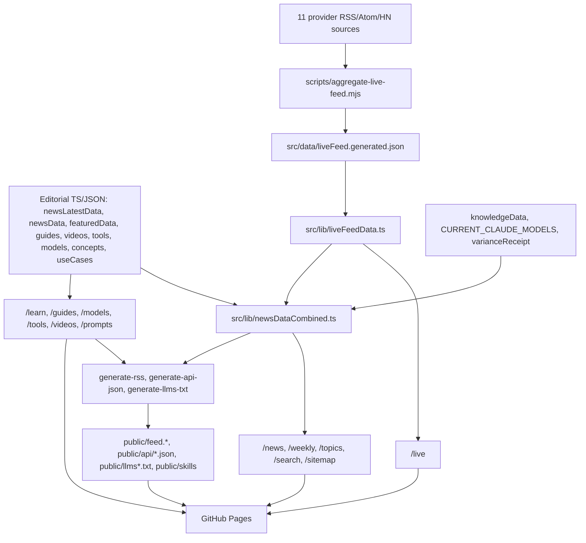

# SINTRA full-stack website audit and dependency map
**Snapshot:** 2026-10-23, default branch `main` SHA `577d4fdcb995242db5acc56b3833417654e0a130`. **Evidence class:** inspected source and GitHub run metadata. **Not performed:** browser interaction, field performance benchmarking, Search Console inspection, independent supplier/content fact-check or full local test execution. Live GitHub Pages HTML could not be fetched by this review. Future metrics are unmeasured.
**Companion:** `docs/BRAZIL_100_STEP_EXECUTION_ROADMAP_20261023.md`.

## Evaluation of prior assistant work
- PR #15 is a **documentation-only draft** (2 files, 219 additions), CI Validate pull request completed success on 2026-10-23 09:04Z. That proves `npm run check` passed on a docs-only branch, **not** that any mobile design, localization, news refactor or community feature has shipped. Brand remains an unverified working code name; no production changes.
- Issues #16, #17, #18, #19 are planning tasks, not completed deliverables. Earlier responses appropriately avoided merging/deploying, but were too optimistic if their conceptual homepage was interpreted as a running app.
- PR #14 Studio remains draft (22 file diff, reviewer-assisted accuracy, real 441-segment example, approvals bound to revision, single-process loopback server). A green PR validation run on 2026-10-23 07:51Z does not demonstrate multi-video accuracy, production auth or public integration.
- PR #13 adds 100 3D *authored recipes*, not 100 executed workflows, and changes 347 files; must inventory conflicts, content discoverability and rights before any merge. PR #9 stale-feed fix is draft and based on an older `main`; do not assume merged.
- Deployed build: scheduled "Build & Deploy" succeeded at 2026-10-23 06:19:56Z on `main`; 2026-10-19 run failed. Deployed HTML was not independently fetched by this review.

## Exact repository structure
```
.
├─ src/app                  # Next.js App Router pages and metadata
├─ src/components           # header/sidebar/cards/hero/search/filters/modal
├─ src/context              # Language, SavedPrompts, Sidebar, Theme
├─ src/hooks                # Feed clock, visits
├─ src/lib                  # canonical-looking but fragmented content registries
├─ src/data                 # useCases.json, liveFeed.generated.json and lab fixtures
├─ src/types                # shared interfaces
├─ scripts                  # aggregation, validation, RSS/JSON/LLM skills generation
│  └─ tests                 # source-based tests
├─ .claude/commands         # manual/agent content update orchestration
├─ .github/workflows        # daily deploy, PR check, dependabot config
├─ public                   # static content, RSS, JSON, llms, SKILL.md, SW and assets
├─ docs                     # audits, runbooks, plans
├─ package.json             # Next 15, React18, TS, Three.js; npm check suite
└─ next.config.mjs          # output export; /sintra-ai production prefix; dist
```

## Route and navigation inventory (main, verified by src/app tree)

| Product area | Routes | Dependency/source | Current issues / target grouping |
|---|---|---|---|
| Start | `/` | `Header`, `ImmersiveHero`, `ContentNav`, `Footer`, `USE_CASES_COUNT` | DOM content SEO-accessible, but three.js always starts if reduced-motion false; inspect mobile cost |
| News | `/news/`, `/news/archive/`, `/news/archive/[month]/` | `newsDataCombined.ts` including generated live items | Merges different editorial trust levels; dynamic month; SEO date provenance |
| Live | `/live/` | `liveFeedData.ts` -> generated JSON | Build-time snapshot (not live polling), source health and status need visible |
| Weekly | `/weekly/`, `/weekly/archive/` | `featuredData.ts` | Hand-curated; THIS_WEEK is 12 Oct, reviewed 18 Oct; warn threshold 14d, no automatic edit |
| Knowledge | `/knowledge/`, `/knowledge/[id]/`, `/research/` | `knowledgeData.ts`, `researchData.ts` | Source and execution status partly present; lots of English summaries |
| Learning | `/learn/`, `/guides/`, `/guides/[slug]/`, `/concepts/`, `/concepts/[slug]/` | `learningPathsData.ts`, `guidesData.ts`, `concepts.ts`; progress localStorage | Paths describe readings, not validated skill proofs; progress device-local |
| Taxonomy | `/topics/`, `/topics/[tag]/`, `/collections/` | `topicsData.ts` cross joins news/tools/concepts/knowledge/prompts; `collections.ts` | Many navigational overlaps, tag-based linking without canonical story identity |
| Build | `/library/`, `/prompts/[slug]/`, `/automate/`, `/ai-labs/` | `src/data/useCases.json` via `data.ts`; `automationData.ts`, `aiLabsData.ts` | Workflow cards describe patterns, not necessarily live executions; prompts contain illustrative sample outputs |
| References | `/tools/`, `/tools/[slug]/`, `/models/`, `/claude/`, `/google-ai-tools/`, `/token-calculator/` | `toolsData.ts`, `modelsData.ts`, `claudeData.ts`, `pricingData.ts` | Volatile provider and price facts should require last-verified + reviewDue |
| Media | `/videos/`, `/ai-history/`, `/resources/` | `videoData.ts`, `timelineData.ts`, `resourcesData.ts` | Video summaries manual English, no stored transcript provenance; uploadDate fabricated from year in VideoObject JSON-LD |
| Integration | `/agents/` | `generate-api-json.ts`, `generate-llms-txt.ts` and public JSON | GET-only static reference files, NOT an interactive MCP or write API |
| Special | `/articles/immersive-apartment-3d/` | independent page | Determine strategic link or appropriate editorial category; check shared layout |

Menu on `SidebarNav.tsx`: three expanded groups (discover ten routes, learn five, reference six), alongside Home and theme choices. `Header.tsx` holds search, saved panel, locale toggle. `ContentNav.tsx` adds intent cards and curated sections. Recommend proposed customer-oriented five destinations `Início | Explorar | Aprender | Construir | Comunidade`, with power-user directory, research and technical docs progressively disclosed. Do not remove canonical URLs.

## Exact content dependency architecture


### Automation and scheduler matrix
| Trigger | Code path | Performs | Guarantee / risk |
|---|---|---|---|
| Daily 06:00 UTC schedule, push to main, manual workflow dispatch | `.github/workflows/deploy.yml` | Node 20 `npm ci`, `npm run check`, publish `dist` to `gh-pages` | Daily refresh **of build-time feed**; CI run success checked, actual deployed page not independently validated |
| All PRs | `.github/workflows/validate.yml` | Node 22 `npm ci` and `npm run check` | Node version differs from deploy; no browser or security-specific gate |
| Every `npm run prebuild` | `scripts/aggregate-live-feed.mjs` | pulls 11 sources concurrently, 12s timeout, 6 per source, 60 total, age cutoff 120 days; writes live snapshot | Source outage skipped. Retains old file if all fail; freshness checker fails >48h or <12 items. Only source count, not minimum working source diversity |
| Follow-on `prebuild` scripts | `generate-rss.ts`, `generate-use-cases-count.ts`, `generate-api-json.ts`, `generate-llms-txt.ts` | generates derived content and count files | Derived outputs use static editorial + promoted live feed. Identical facts can exist in multiple formats |
| CLI standalone | `scripts/update-news.mjs` | Anthropic SDK/web-search request and append to **historical `newsData.ts`** | **Conflicts** with Claude command recommendation to append to `newsLatestData.ts`. Not in deploy.yml; no evidence of scheduled execution from repo |
| Command/agent manual task | `.claude/commands/update-news.md` | research 3–8 curated sources; append to **`newsLatestData.ts`**, validate, push main; log issue | Instruction, not self-running GitHub workflow. May publish by direct main push; no editor approval enforced in code |
| Agent command | `.claude/commands/update-sintra.md` | news, conditional use-case addition, validate, deploy & readback | Agent instructions, not evidence of a scheduled job |
| `npm run audit:static` | `audit-freshness.mjs`, `validate-latest-news.ts`, tests | schema/date/duplicate checks, news review schema, typechecks, export | Structural validity is not primary-source verification; weekly age >14d is WARN not blocker |
| UI newsletter submit | `Footer.tsx` and optional `NEXT_PUBLIC_NEWSLETTER_ENDPOINT` | POSTs email to configured external endpoint | No provider/configuration/verified delivery evidence. UI explicitly displays disabled if unset |

### Current source registry for aggregated feed
Google DeepMind RSS; Google AI RSS; OpenAI RSS; Hugging Face RSS; arXiv cs.AI Atom; BAIR Berkeley RSS; MIT Technology Review RSS; TechCrunch AI RSS; VentureBeat AI RSS; Simon Willison Atom; Hacker News Algolia JSON. ArXiv registry uses HTTP but article permalinks are force-upgraded to HTTPS; test compatibility rather than assuming endpoint upgrade. Provider terms/ToS and feed uptime to be checked.

### News and summary semantics
- `newsLatestData.ts` curated editorial items normally have title, 2–3 factual sentences, tags, significance, source URL, provider, `why_it_matters`, `what_to_try`, optional country.
- `newsData.ts` historical corpus and 2026 standalone updater: broad NewsItem schema, some URLs optional.
- `liveFeed.generated.json` automated provider excerpt `summary` up to 260 chars; HN summary is points/comments, **not** researched analysis.
- `newsDataCombined.ts` priority in executed code: lab publication, source-checked knowledge/model records, curated latest, historical, promoted 18 live signals. Drops duplicates by ID and normalized title; **does not guarantee URL/event semantic dedup**. "primary-checked", "editorial", "aggregated", "lab-tested" origin labels exist but user-readable evidence disclosure not demonstrated on every card.
- `featuredData.ts` manual weekly 4-card selection, not generated weekly by build; has independent archive and link list. A historic item may have a current provider main news URL not an exact article permalink.
- `/news` uses current month from highest `dateNum`; automated promoted items can dominate the displayed month. Article cards link to external publishers rather than Sintra's first-party article in many cases.
- `src/app/news/page.tsx` `toISODate(dateNum, dateDay)` defaults missing historical day to **first of month** in JSON-LD. Structured data must not invent publication precision.
- `scripts/generate-rss.ts` labels RSS/JSON `en-us` and republishes many external sources as feed entries. Separate attribution/curation from original ownership; trust policy.
- Generated public `feed.json` on tracked main is older than today's live workflow; **do not claim tracked file is live feed freshness**. Tracked `liveFeed.generated.json` snapshot says `2026-07-19`, whereas daily workflow on 2026-10-23 passed: regenerated artifacts may be deployed without being committed to main. Verify deployed output before drawing freshness conclusions.

### Video pipeline
`src/lib/videoData.ts` static list: `id, videoId, title, channel, summary, url, tags, duration?, year?`.
`/videos/`: categorized/searchable cards, YouTube thumbnail, modal embedded iframe, static metadata/JSON-LD.
**Not seen** in main: automatic transcript ingestion, timestamped chapter summaries, claims/citations, provider-sync, multilingual canonical descriptions, copyright/embedding check or video availability monitoring.
`src/app/videos/page.tsx` uses `uploadDate: year-01-01` when year exists: **fabricated precision**. Delete that field until exact verified date is available, then add real date per video. Titles/summaries contain high-impact contemporary claims that require external verification.
Studio PR #14: local caption -> evidence -> Portuguese draft with human-gated export; NOT connected to public published videos or bulk automatic journal production.

### Use cases, learning and knowledge
- Canonical raw use cases in `src/data/useCases.json`; `src/lib/data.ts` adapts to strongly typed UI shape. Use cases include user inputs, source text, tools, difficulty, expected output and sample output, but samples are illustrative, not executed proof.
- `learningPathsData.ts` lists four major pathway groups with concept/use-case/tool/page/read steps; `LearningPathsPage.tsx` tracks completion as localStorage state, not verified learning or transferable account progress.
- `knowledgeData.ts` contains sourceIds, source review dates, limitations, audience/type/status and example procedures; this **stronger provenance pattern should become standard** across other content rather than rebuilding it.
- `topicsData.ts` recombines prompts, news, tools, concepts, knowledge using tags/search. `collections.ts` filters use cases. `searchIndex.ts` fuses all domains in client-side search, potentially large bundles and inconsistent ranking; measure before redesign.
- Build-generated `public/api/index.json` explicitly says static HTTPS GET, no MCP server; individual knowledge JSON and SKILL.md available; use compact index first.
- `llms-full.txt` concatenates large sections; retrieval efficiency needs measurement. Do not treat `llms.txt` as a ranking lever or evidence quality signal.

### Locale, accessibility, visual design
- `src/lib/i18n.ts` houses EN/PT label strings only; `LanguageContext.tsx` renders EN initially, then reads localStorage/browser language post-hydration. `src/app/layout.tsx` statically renders `html lang=en`. That is not an independently crawlable Portuguese content route and switching labels cannot localize English data modules.
- `next.config.mjs` static export, production `/sintra-ai` prefix. All route migration and redirects need static hosting constraints tested.
- Current design: Manrope / Instrument Serif / Geist Mono, violet/cyan/orange accents, a Three.js tesseract hero with particles and scroll response, motion controls, themes; desktop sidebar-heavy. Actual runtime performance and screenshots not measured in this audit.
- `ImmersiveHero.tsx` initializes Three.js for non-reduced-motion users and caps pixel ratio 1.75, but does not exempt low-memory/touch devices. Need measured CPU/GPU cost and reduced-data modes.
- Header opens command palette, saved prompts panel and language toggle. Footer newsletter requires externally configured endpoint; no verified subscription processing from code.
- UX risks: internal taxonomy exposed as destination maze, multilingual page content mismatch, comparison data volatility, expertise/execution status not obvious enough, visual distinction between verified article and provider feed needed.

## Risk and dedup/refactor shortlist, ordered

| Severity | Source evidence | Problem | Smallest safe correction |
|---|---|---|---|
| P0 | videos route JSON-LD | fabricated `year-01-01` uploadDate | remove until actual source date |
| P0 | news route JSON-LD | fabricated `YYYY-MM-01` for month-only | omit date for unknown day or change typed precision with clearly justified date |
| P0 | `update-news.mjs` vs `.claude/commands/update-news.md` | different write targets + non-equivalent validation | one editorial content writer into canonical schema, migration tests |
| P0 | content model and site copy | promoted aggregated signal can be indistinguishable from editorial verification | distinct news states and publisher attribution |
| P0 | locale/root layout | English crawlable body and `lang=en`, pt switch client-side | actual pt-BR/en rendered page routes |
| P0 | public brand | unrelated `sintra.ai` commercial company | formal trademark/domain/identity review |
| P1 | aggregator source errors | skips failed providers, low source diversity may still pass | per-source health, source quorum, degraded badge and alert |
| P1 | publication and metadata freshness | build regeneratedAt used separately from source review date | distinguish event published/retrieved/checked/generated |
| P1 | `newsDataCombined` | de-dupe by id/title, not full URLs or event identity | canonical event ID and link/semantic review, regression corpus |
| P1 | newsletter | optional endpoint with unknown delivery/opt-in | clear disabled status and E2E double opt-in before campaign |
| P1 | learning | localStorage click progress | verify first useful result instead of clicks |
| P1 | security/runtime | auth/community not present on static site | introduce isolated backend only after threat-model and LGPD review |
| P1 | pipeline hygiene | Node 20 deploy vs Node 22 PR | pin/test same runtime and lockfiles |
| P1 | homepage rendering | unconditional canvas for capable non-reduced devices | performance trace, lazy/optional visual |
| P2 | weak metadata and content duplication | many static text files and generated copies | typed canonical source and generated projections, drift tests |
| P2 | two hero components and overlapping navs | implementation duplication | decide retain/retire via usage scan and visual/regression tests |
| P2 | stale weekly feature | human updated, stale by design and warning | automated reminder and explicit "Reviewed" timestamp, not fabricated weekly refresh |

## Proposed target architecture

```mermaid
flowchart LR
  providers["Official sources / videos / approved member submissions"] --> ingest["Source adapters + rights checks"]
  ingest --> normalize["Parse + normalized typed record + deterministic dedup"]
  normalize --> catalog["Provenance catalog and immutable source revisions"]
  catalog --> packet["Bounded evidence packet"]
  packet --> llm["LLM draft / pt-BR + English adaptation"]
  llm --> verify["Schema / citation / primary source checks"]
  verify --> review["Human editorial review; approval bound to revision"]
  review --> publish["Canonical CMS/Git content record"]
  publish --> static["Static locale pages, feeds, API JSON and lightweight search index"]
  static --> web["Public portal: Início / Explorar / Aprender / Construir / Comunidade"]
  web --> member["Isolated authenticated community API"]
  member --> db["Postgres / RLS / moderation / audit"]
  member --> metrics["Privacy-minimal verified actions"]
  metrics --> triage["Product and editorial backlog"]
```

Use explicit adapters, permissions and measurable boundaries. Avoid a premature rewrite to microservices. Keep one source of truth for content, one locale strategy and one owner/editor review model. LLM-assisted translation is a draft, not automatically trusted or a substitute for culturally appropriate pt-BR editorial review.

## Observability and measurable outcomes
Engineering: p50/p95 route and pipeline latency, upstream success/timeout, JS/GPU cost, accessibility issues, Core Web Vitals at p75, bundle sizes, test flake, CI duration, build determinism.
Data: canonical event duplicates, citation support per claim, source reliability, stale snapshots, published correction latency, preview→approved conversion, manually reviewed quality.
Business: useful first task completed in 7d, returning verified contributors in week 4, projects published per active cohort, newsletter confirmed subscriber engagement, organic growth, unit cost per accepted verified article.
Cost: provider tokens per accepted article, failures/retries, retrieval bytes and cache effects. All targets require a measured baseline and explicit operational owner.

## External standard references
- https://developers.google.com/search/docs/specialty/international/managing-multi-regional-sites
- https://developers.google.com/search/docs/specialty/international/localized-versions
- https://developers.google.com/search/docs/appearance/core-web-vitals
- https://developers.google.com/search/docs/fundamentals/ai-optimization-guide
- https://www.w3.org/WAI/standards-guidelines/wcag/
- https://owasp.org/www-project-application-security-verification-standard/
- https://cetic.br/

## Audit limitations
The current work consists of inspected repository files, CI metadata and architecture analysis. No live site browser screenshot, Lighthouse audit, end-to-end rebuild or model/provider content fact-check was executed here. Final page count and route count must be extracted from current exported build rather than old docs. Any proposed thresholds are **acceptance criteria, not measured results**. Maintain this distinction in later status reports.
