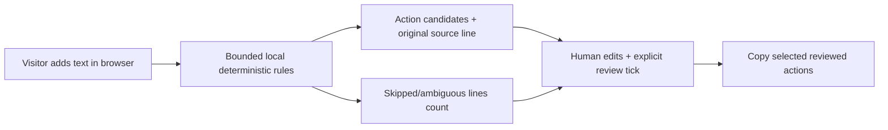

# Sintra Brasil: evidence-backed engineering learning and first-use architecture

**Date:** 2026-10-24. **Base:** draft release PR #31, branch `release/sintra-br-beta-20261024`, verified CI at `46c147a9`. **First-win branch:** `feat/sintra-first-real-exercise-20261024`. No production merge/deploy, member data processing or outbound email is implied.

## 1. What we learned from the last 48 hours

| Decision | Evidence and outcome | New understanding | Keep / change |
|---|---|---|---|
| A static hero instead of Three.js-critical homepage | Homepage initial bundle reduced from roughly 520 KB to 127 KB in comparable Next build reports | Visual novelty has a real client JS/CPU cost and can hide the core job | **Keep the CSS/visual identity**; 3D belongs in optional article experiences, not required first paint |
| Brazil first, then world | Build-time snapshots pulled two Brazilian providers and eleven international adapters; source coverage varies by run | A Portuguese publisher is not proof an event is Brazilian. Headlines aren't checked facts | **Keep source badges**, add verified Brazil-impact classification and source health before publishing original synthesis |
| Small server-selected data projection | After removing client `ContentNav` and sidebar import of entire news/tools directories, 513 static pages still export and links validate | Feature count is not correlated with client bundle size if server/client boundaries are respected | **Keep** this boundary as policy for new pages; no client import of full catalogs for counters |
| One reusable ond.ai design system | PR #29 uses porcelain/ink/violet with Sintra coral and common lockup; other old pages still show legacy text | Design is a system, not a single hero | **Continue refactor by templates**, not global CSS overrides without browser evidence |
| Reproducible builds over exact temporary fonts | Next's Google font loader intermittently failed in CI; PR #31 removed build-time network fetch | Network-dependent typography can block release, but fallback glyph metrics differ | **Keep fallback for beta**, later pin licensed Inter/EB Garamond assets and test actual glyph/line wraps |
| PR-stack reconciliation | 4 source-correctness PRs were brought into one release branch; 110 tests, 6 responsive widths passed | Individual green PRs are insufficient; consolidated integration must be tested at artifact level | **Keep isolated source PRs**, make one release candidate with an audit trail and rollback |
| Early website sharing | One user-initiated share action, no automatic messages | Social distribution should follow useful achievements, not passive views or spam | **Keep voluntary share**, measure qualified useful action, not click volume |
| Existing library prompt deep-link | A user could open an English prompt but could not complete the task inside Sintra | "Try an example" is a weaker product promise than actual completed outcome | **Change:** first real interactive, private lab with transparent processing |

### What was not proven

The ~76% reduction measures a Next.js reported first-load JS figure, **not** measured field LCP/INP or CPU on low-end phones. A six-width Chromium test does not constitute a physical Samsung test or full screen-reader/200% zoom compliance. RSS signal ingestion is not semantic relevance/fact-checking. Login/Supabase RLS foundation exists but is not an end-to-end member experience. The user-supplied brand boards and recreated wave still require original master/legal confirmation. Older route templates still need brand review.

## 2. Proposed first-win architecture

**User goal:** transform notes into a useful, reviewable action list.

### Why local rules first?

| Alternative | Advantage | Limitation / decision |
|---|---|---|
| Dummy hard-coded results | Fast mockup | **Rejected**. Misleads about execution and gives zero evidence of useful behavior |
| Direct browser-to-LLM API | Fast apparent AI capability | **Rejected**. Static client would expose provider credentials, quotas and uncontrolled costs, and user text could leak to a vendor |
| Immediate paid model backend | Handles freer text and languages | Deferred until controls and external quality benchmark are in place; requires consent, auth/anonymous quotas, rate limiting, prompt-injection defenses, evidence grounding, expiry, cost budget and deletion |
| Deterministic local extraction | Runs now, zero model/API cost; no user note transmission; exact provenance, testable abstention | **Chosen for foundational learning**. It is **not AI** and cannot understand ambiguous meetings reliably. It exposes the blind spots rather than inventing completion |

The new lab deliberately processes only explicit action verbs in line-oriented notes. Owners and deadlines are copied only when users **explicitly label** them; relative dates such as "sexta-feira" remain original text, not fabricated ISO calendar days. Unrecognized prose is skipped, reported and never turned into a fictional task. Every extracted candidate shows its exact originating line and requires user review before its action can be copied. Editing invalidates the review check.

**Privacy:** text stays in the browser's memory; this module does not call a model or store notes in localStorage/remote APIs. The global static app can still load external website analytics, and browser/extension/device security remains outside this guarantee. The UI tells users to avoid sensitive notes on shared devices. The lab has no direct Supabase or external sending dependency.

### Limits and user-visible truth

- No agent or LLM call, no translation of arbitrary documents, no personal-data upload, no token consumption.
- Character cap: 4,000; item cap: 15. Excess input fails rather than silently truncating sensitive lines.
- Many legitimate instructions are missed if written conversationally or without an explicit opening verb.
- Titles and metadata are editable; the algorithm never claims ground truth or a calibrated confidence percentage.
- Usability measures, not fabricated "AI accuracy": sample completed task, source trace preserved, user able to review/copy, time-to-first-useful-output on phone, genuine user failure reports.

## 3. Evaluation protocol for upgrading to actual model inference

1. Gather a small, consented **Brazilian Portuguese** dataset, with separate held-out professional contexts: meeting notes, student work, freelance service, small-business sales and finance.
2. Label **exact actionable tasks, source spans, explicit owners and deadlines, negations and non-tasks**, including cases where abstention is correct.
3. Run the local baseline and one proposed LLM mode against the exact same records. Track action-level precision/recall/F1, source-span support, invented deadline/owner rate, privacy failures, p50/p95 latency, token/cost per *accepted human-reviewed action*, retries and error rates.
4. Block auto-publication/copying unless the human explicitly reviews results. The LLM must *not* create assignments or dates absent from evidence.
5. Require backend architecture: Supabase Edge Function or separate trusted service, with JWT or secure anonymous quota, secret stored server-side, bound input size/timeouts, egress and model allowlist, idempotency, redacted logs, privacy/retention and user consent.
6. Run red-team inputs: prompt-injection text inside notes, encoded HTML, spoofed owners, contradictory dates, very long lines, malicious URLs, duplicate tasks and provider timeout/429.
7. Ship model mode behind an explicit opt-in, feature flag and rollout, while retaining the private rule-based mode as a fallback and educational baseline.

**Proposed comparative acceptance criteria (not yet measured):** no critical privacy leakage; 0 invented owners/deadlines in the held-out regression corpus; explicit span provenance for every copied action; meaningful gain in recall at a human-audited precision threshold of at least 95%; bounded price per 1,000 successful user actions. Real targets and budget must be approved after baseline sampling.

## 4. Architecture and modularity rules for ond.ai product families

- **`src/lib/meetingActions.ts`**: pure rules and output contracts, no UI, network, credentials, timers or storage. Portable into other education workflows and cheap to test.
- **`MeetingActionsLab.tsx`**: localized interaction state, review gating and voluntary clipboard action; no business rules duplicated.
- **`MeetingActionsLab.module.css`**: existing brand semantics: porcelain/ink, coral evidence/review accent, accessible 44px controls, 320px stacking, reduced motion.
- **`src/app/laboratorio/page.tsx`**: static discoverable page shell and metadata; use established Header/Footer.
- **Home**: link primary hero to actual functionality and retain source catalog provenance. Avoid reusing the English-only prompt page as the new Brazilian "first win".
- **Validation**: independent pure-engine tests, e2e browser sample/evidence/review tests, beta render/overflow, structural no-network checks.
- **Governance:** future labs can share a `TaskInput → EvidencePacket → Candidate → Reviewer → ApprovedOutcome` contract, but avoid creating an unnecessary framework or microservice until two real vertical slices prove reusable requirements.

## 5. Next priorities after this slice

**P0:** test source-grounded local lab; fix any Chrome/mobile failures; add a clearly marked route to brand navigation. **P0:** reconcile real model backend boundary and auth/quotas before offering external processing. **P1:** apply brand and locale consistency to the old prompt detail page, News, Learn and Library. **P1:** make real indexable pt-BR/en routes (current toggle is still post-hydration). **P1:** convert reviewed news into publication-bound multilingual articles/newsletters. **P2:** community progress/publishing via HoldingCo with RLS+moderation, consent and deletion.

**Release contract:** feature PR stacked on PR #31, no merge to `main`, no Supabase migrations, no model API call, no outbound email. Synthetic unit tests and one browser example do **not** demonstrate real-world action extraction accuracy.
