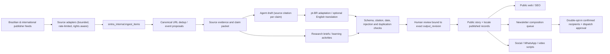

# Sintra on HoldingCo / ond.ai: backend architecture and operational contract

**Applied:** 2026-10-23 to the connected Supabase project `HoldingCo`, ref `ogdndkbvlebzqbnwaevm`, eu-north-1.
**Remote migration:** `20261023162525_sintra_holdingco_foundation`.
**Canonical SQL:** `docs/database/SINTRA_HOLDINGCO_FOUNDATION.sql`.
**State:** backend TABLES CREATED and security metadata checked; no Auth UI, provider integration, cron, outgoing email or content publishing enabled.

## Important company model
HoldingCo is the shared, private infrastructure identity of **ond.ai** (company working codename). Every product uses an explicit schema/table namespace and own permission boundary, not a blanket company-wide RLS rule.

- Supabase `auth.users` is shared identity. A user signing into one ond.ai product is **not automatically authorized** to the other product's domain data.
- Sintra exposes `public.sintra_*` only with explicit SQL grants and row-level rules. Other business tools must have separate tables and policies.
- `sintra_internal.*` is **not** an exposed browser API; no `anon` or `authenticated` grants, RLS on every table, only trusted backend service access.
- Never put `service_role`, `sb_secret_*`, API tokens, SMTP credentials, model provider keys or newsletter addresses into static Next.js code, `NEXT_PUBLIC_*` variables, GitHub commits, client JSON or screenshots.

## Verified table inventory
| Table | Intended data and access |
|---|---|
| public.sintra_profiles | Member-provided display name/bio; user reads/updates only own |
| public.sintra_editor_roles | Dedicated editor/moderator/admin role assignments; user reads only own; writes by trusted backend |
| public.sintra_projects | User draft/submission, published public read, owner draft update/delete; no client self-publication |
| public.sintra_comments | User may submit pending comment on published projects; public sees approved comments only |
| public.sintra_stories | Source-grounded articles and states; only published stories public; no direct browser write |
| public.sintra_story_locales | Reviewed pt-BR/en localized editions; only published variants of published stories visible |
| sintra_internal.sources | Publisher registry and source health |
| sintra_internal.ingest_items | Canonical URLs, publisher excerpts, original dates/retrieval metadata; no mass copyrighted full-body storage |
| sintra_internal.content_jobs | Jobs for news/translation/article/research/newsletter with revision-bound approval and token/cost metadata |
| sintra_internal.newsletter_subscriptions | Email addresses, language and pending/confirmed/unsubscribed consent; never public |

**RLS verification:** 10 of 10 tables enabled, 14 public policies inspected, no table rows or Auth users inserted. Permissions checked: `anon` and `authenticated` have no USAGE on `sintra_internal`, no SELECT on private newsletters, no editor-role INSERT/UPDATE and no article INSERT. Anonymous SELECT of published news is available through RLS.

Four Supabase Security Advisor INFO notices note private tables with RLS but no policies. **Intentional deny-all policy**, not an exposed read. Reference: https://supabase.com/docs/guides/database/database-linter?lint=0008_rls_enabled_no_policy . Security and performance advisors had no other findings at this foundation stage.

## Backend workflow: one content core, many output channels

### Job state machine
`queued → running → needs_review → approved → published`; `failed` and `cancelled` as explicit outcomes. Retries use one idempotency key; approval must match `output_revision`. Every job records input/evidence snapshots, model/version, tokens, cost, failures and disposition. Publishing is an authorized action, distinct from generating text.

### Brazilian editorial schema
A story records `geography=BR|WORLD`; **a Brazilian publisher is not by itself evidence of Brazilian event impact**. Prioritize stories with meaningful implications for Brazilian people, businesses, rules and tools. Editorial locale is pt-BR. Original publisher title/excerpt must be attributed and never relabeled as independent verified Sintra analysis. Translation is reviewable versioned adaptation, preserving exact product names and uncertainty.

Suggested pt-BR output: one sentence factual answer; 60–90-word overview; "Por que importa no Brasil"; "O que você pode testar hoje"; original source link and publication/review dates; optional intermediate/advanced walkthrough. Each output cites concrete evidence. A claimed test must have a reproducible execution receipt, otherwise label example-only.

## One account → community, not automatic publication
1. User requests sign-up via Supabase Auth (email/password or verified magic link). Auth UI should be a separate PR with pinned `@supabase/supabase-js`, locked dependencies and correct Auth redirect allowlist.
2. On first login, user explicitly creates a `sintra_profiles` record linked to `auth.uid()`; no trigger with elevated privileges required.
3. User can save `sintra_projects` drafts and submit; submission is not visible until a moderator approves it.
4. Public comments start `pending`; they require moderation before global visibility.
5. Role grants in `sintra_editor_roles` cannot be set by clients, including through mutable user metadata.
6. Editor/moderator actions execute through a backend endpoint that revalidates Auth JWT and checks role with trusted database access, enforces CSRF/CORS/size limits and emits an audit receipt. Never trust a hidden admin button.
7. Account export/delete, reporting, appeals, consent and moderation SLAs are required before public registration.

## Newsletters and contact channel
`konamundo@gmail.com` is **an administrative contact**, not a configured bulk sender. Do not store it as a sender key, send automatically from Gmail, or promise delivery. Newsletter subscriber emails are held only in `sintra_internal.newsletter_subscriptions`. Consent begins `pending` and must be confirmed through token verification; only `confirmed` may receive mail. Maintain unsubscribe/suppression list, provider webhooks and retry/duplicate controls. Proposed provider should offer Brazilian deliverability/consent and transparent pricing. Newsletter creation from approved story revisions can be automated; distribution requires separate explicit policy approval and quota/bounce safety.

## Static Next.js 15 limitation and migration
Current GitHub Pages `output:'export'` has no server runtime and its language toggle changes client text after hydration. It can still use a **browser-only Supabase Auth client** for simple sign-in + direct RLS-bound reads/writes, but cannot securely hold secret keys, perform privileged publishing, send newsletters or protect moderation controls itself. Supabase Edge Functions or a dedicated server host must perform private actions. Use the appropriate cookie/PCKE flow only after hosting changes are evaluated; never pretend the static site provides server-side session checks.
True indexed `/pt-br/` and `/en/` pages with correct SSR/static root `html lang`, alternate metadata and content remain a distinct engineering stage.

## Mandatory release gates
- No production Auth UI until URL redirect allowlist, email verification, CAPTCHA/rate limits, password reset, multi-tenant RLS tests, consent/delete and abuse controls are confirmed.
- No privileged Edge Function exposed until role-specific authorization, JWT verification, request signature/rate limiting, audit log and secrets have been tested.
- No automatic bulk email or publisher article replication without rights, review, opt-in/opt-out, bounce handling and distribution approval.
- No automatic remote publishing from model results. No backdating publication day or fabricated reviewer identity.
- Run Supabase security and performance advisors after each migration, plus SQL role-isolation tests and real authenticated user tests before onboarding public users.
- Benchmark ingestion source coverage, citation precision/recall, summary accuracy, locale editorial quality, latency/tokens/retries, and cost per accepted article before scaling.

## Immediate engineering sequence
A. Database foundation COMPLETE, as verified by project migration list and Supabase metadata.
B. Auth SDK + user login/register on static hosted origin, isolated branch, pinned packages/lock and E2E verified callbacks. **Not yet implemented**.
C. Edge Function moderator/editor backend with explicit privileges and revision-bound publication. **Not yet implemented**.
D. Browser member project submission/approval loop plus anti-abuse. **Not yet implemented**.
E. Server ingestion job that persists actual publisher signals to `sintra_internal.ingest_items`, then evidence/translation/evaluation/editorial Studio. **Not yet implemented**.
F. Newsletter double opt-in and approved sending workflow. **Not yet implemented**.

### Primary reference guidance
- https://supabase.com/docs/guides/auth
- https://supabase.com/docs/guides/database/postgres/row-level-security
- https://supabase.com/docs/guides/auth/server-side
- https://supabase.com/docs/guides/security/product-security
